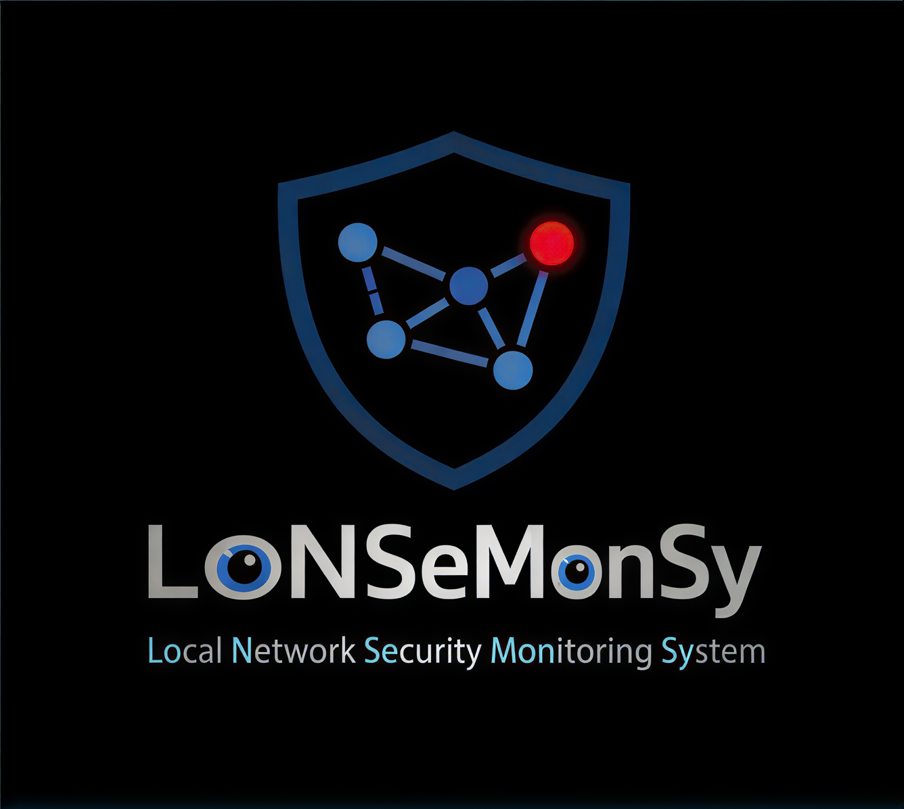
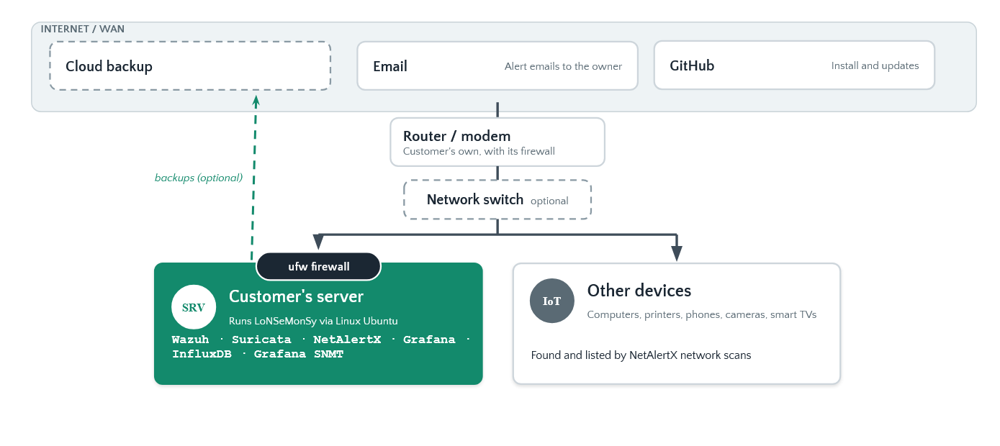

<div align="center">



# LoNSeMonSy

**Local Network Security Monitoring System**

Security monitoring for small networks, on one Ubuntu machine.


[](https://github.com/LoNSeMonSy/Main/actions/workflows/lint.yml)

</div>

## Features

- **Attack detection** on every computer with a Wazuh agent: suspicious logins, attacks, changed system files, vulnerable software
- **Auto-block:** an address that keeps failing to log in over SSH is blocked for 10 minutes
- **New device alarm:** NetAlertX spots unknown devices on the network
- **Port scan alarm:** Suricata spots scans of this machine
- **Firewall on by default:** only the ports LoNSeMonSy needs, only from your network
- **One dashboard:** Grafana's Active Alarms page, with email alarms
- **Update check:** Grafana shows when a new version is out
- **Cloud backup (optional):** encrypted nightly copies to an S3 or Backblaze bucket, with an alarm if they stop

LoNSeMonSy finds problems and tells you within minutes. It doesn't replace your router's firewall, antivirus or updates.



## Requirements

| | Minimum | Recommended |
|---|---|---|
| CPU | 4 cores | 4 or more |
| Memory | 8 GB | 16 GB |
| Disk | 50 GB SSD | 100 GB SSD |
| System | [Ubuntu Server](https://ubuntu.com/download/server) 22.04 or 24.04 | |
| Network | wired, on the same network as the computers it watches | its IP address reserved on the router |

Enough for about 25 computers.

## Install

```bash
git clone https://github.com/LoNSeMonSy/Main.git lonsemonsy && cd lonsemonsy
sudo ./setup/setup.sh
```

## Using it

| Command | What it does |
|---|---|
| `lonsemonsy` | shows the addresses, the version and these commands |
| `lonsemonsy passwords` | shows the Grafana and Wazuh passwords |
| `lonsemonsy status` | shows whether everything is running |
| `lonsemonsy firewall` | shows which ports are open |
| `lonsemonsy update` | updates to the newest version |
| `lonsemonsy backup` | makes a cloud backup now |
| `lonsemonsy restore` | puts the newest cloud backup back |

To protect a computer, install a Wazuh agent on it: [wazuh/README.md](wazuh/README.md)

**Email alarms** are sent from a Gmail account. Use a separate one made just for this, with an [app password](https://myaccount.google.com/apppasswords) (not its normal password; needs 2-Step Verification).

## What's inside

| Part | Job |
|---|---|
| [Wazuh](https://documentation.wazuh.com/current/index.html) | detection engine and agents |
| [Suricata](https://docs.suricata.io/) | port-scan detection |
| [NetAlertX](https://docs.netalertx.com/) | device discovery |
| [Grafana](https://grafana.com/docs/grafana/latest/) | dashboards and email alarms |
| [InfluxDB](https://docs.influxdata.com/influxdb/v2/) | stores measurements over time |
| [ufw](https://documentation.ubuntu.com/server/how-to/security/firewalls/) | the firewall |

Versions are pinned in [`setup/PINNED_VERSIONS`](setup/PINNED_VERSIONS). LoNSeMonSy's own version is in `setup/VERSION`, and what changed in [`setup/CHANGELOG.md`](setup/CHANGELOG.md).

```
appliance/   Docker Compose, Grafana dashboards and alarms, Suricata
setup/       setup.sh and its steps, update.sh, the lonsemonsy command
wazuh/       detection rules, auto-block, adding a computer
systems/     every system we use
lint/        code checks
images/      logo and diagram
```

## Development

Branches: `dev` → `staging` → `main`. Code checks: [lint/](lint/)

## Team

Tim Smith · Avery Schmoyer · Logan Herndon, CPSC 355 Software Engineering II · [MIT license](LICENSE)
