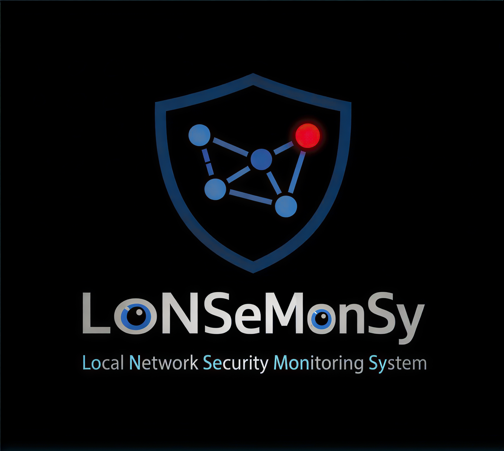
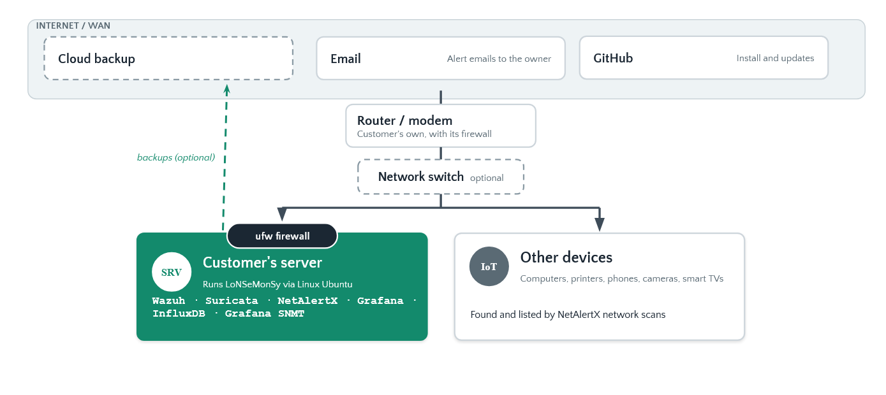

<div align="center">



# LoNSeMonSy

**Local Network Security Monitoring System**

See the unseen within your private local network.


</div>

## Features

- **Attack detection** on every computer with a Wazuh agent: suspicious logins, attacks, changed system files, vulnerable software
- **Auto-block:** an address that keeps failing to log in over SSH is blocked for 10 minutes
- **New device alarm:** NetAlertX spots unknown devices on the network
- **Port scan alarm:** Suricata spots scans of this machine
- **Firewall on by default:** only the ports LoNSeMonSy needs, only from your network
- **AI alarm explainer (optional):** a short plain-English note on each serious alarm, what happened and what to do; it runs on your own network
- **One dashboard:** Grafana's Alarms page, with email alarms
- **Vulnerabilities page:** pick a device, see which software to update and which settings to fix
- **Audit page:** who logged in, failed logins, admin commands, account and file changes
- **System Health page:** CPU, memory, disk and network of the server, with alarms when the disk or memory fills up
- **Update check:** Grafana shows when a new version is out
- **Backups every night:** on the server, and optionally to Amazon S3 or Backblaze, encrypted, with an alarm if they stop
- **Remote access (optional):** open the dashboards from anywhere over HTTPS with Tailscale

LoNSeMonSy finds problems and tells you within minutes. It doesn't replace your router's firewall, antivirus or updates.



## Requirements

| | Minimum | Recommended |
|---|---|---|
| CPU | 4 cores | 4 or more |
| Memory | 8 GB | 16 GB |
| Disk | 50 GB SSD | 100 GB SSD |
| System | [Ubuntu Server](https://ubuntu.com/download/server) 22.04 or 24.04 | |
| Network | wired, on the same network as the computers it watches | its IP address reserved on the router |

Enough for about 25 computers.

## Install

```bash
git clone https://github.com/LoNSeMonSy/Main.git lonsemonsy && cd lonsemonsy
sudo ./setup/setup.sh
```

## Using it

| Command | What it does |
|---|---|
| `lsmsy` | shows the addresses, the version and these commands |
| `lsmsy password` | sets a new Grafana, Wazuh or NetAlertX password |
| `lsmsy status` | shows whether everything is running |
| `lsmsy firewall` | shows which ports are open |
| `lsmsy update` | updates to the newest version |
| `lsmsy backup` | makes a backup now (`lsmsy backup time 11pm` changes the nightly time, `lsmsy backup setup` adds a cloud copy) |
| `lsmsy restore` | puts the newest backup back (`lsmsy restore cloud` uses the cloud copy) |
| `lsmsy users` | lists the Grafana accounts, and adds or removes one |
| `lsmsy report` | shows this week's security summary (also emailed on Mondays) |
| `lsmsy test` | sends a fake alarm to check that alarms and email work |
| `lsmsy remote` | turns HTTPS access from anywhere with Tailscale on or off |
| `lsmsy ai on` | turns on AI explanations of alarms (`lsmsy ai off` turns them off) |

To protect a computer, install a Wazuh agent on it: [wazuh/README.md](wazuh/README.md)

Not sure what to answer during setup? Type `?` at any question, or see [setup/HELP.md](setup/HELP.md).

## What's inside

| Part | Job |
|---|---|
| [Wazuh](https://documentation.wazuh.com/current/index.html) | detection engine and agents |
| [Suricata](https://docs.suricata.io/) | port-scan detection |
| [NetAlertX](https://docs.netalertx.com/) | device discovery |
| [Grafana](https://grafana.com/docs/grafana/latest/) | dashboards and email alarms |
| [InfluxDB](https://docs.influxdata.com/influxdb/v2/) | stores measurements over time |
| [Telegraf](https://docs.influxdata.com/telegraf/v1/) | collects the server's health numbers |
| [n8n](https://docs.n8n.io/) and [Ollama](https://ollama.com/) | the AI alarm explainer (Gemma 3 model) |
| [Tailscale](https://tailscale.com/kb/) | remote access |
| [ufw](https://documentation.ubuntu.com/server/how-to/security/firewalls/) | the firewall |

## Team

Tim Smith · Avery Schmoyer · Logan Herndon, CPSC 355 Software Engineering II · [MIT license](LICENSE)
