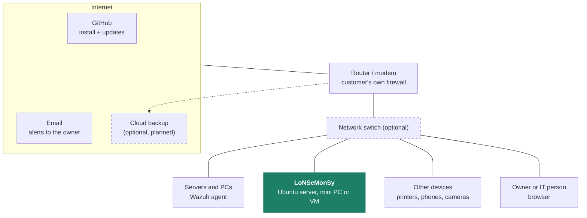
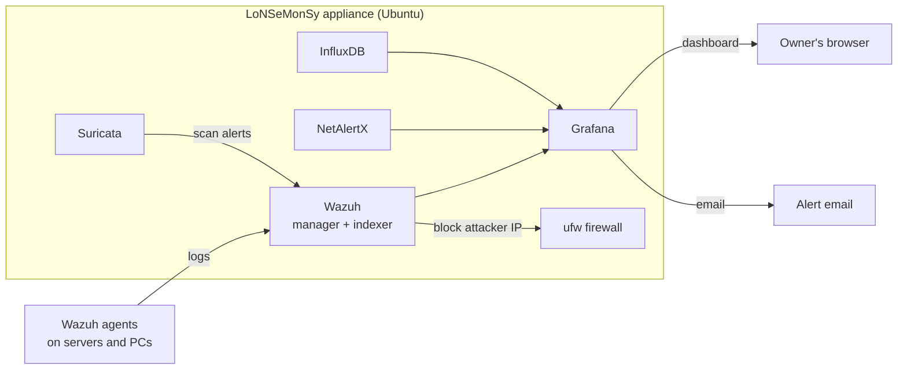

# Architecture

## On the customer's network

LoNSeMonSy is one Ubuntu machine on the local network. Nothing else is required. A switch and cloud backup are optional.

## Inside the appliance

| Port | Service | Who connects |
|---|---|---|
| 3000 | Grafana | the owner's browser |
| 1514 / 1515 | Wazuh | agents on monitored machines |
| 443 | Wazuh dashboard (advanced) | IT person |
| 20211 | NetAlertX | IT person |

Everything else stays on the appliance itself.
