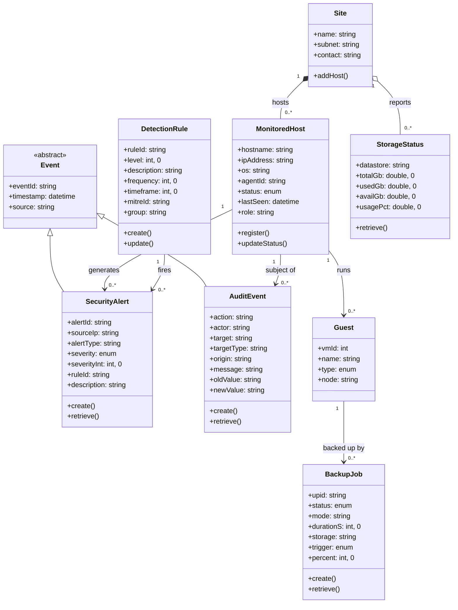

# LoNSeMonSy — Conceptual Class Diagram (Sprint 2)

This is a **conceptual** class diagram (Analysis / OOA level): it models the **data the
system stores and remembers** — the nouns of the problem domain in plain language — not the
code-level classes. Per the course, we move to specification/implementation-level diagrams
later in Design.

> Team: review this against our SRS and user stories before the demo. Adjust names/attributes
> to match our own wording — you should be able to explain every class and association.

## What each class stores and why

| Class | Purpose (data at rest) | Backed by |
|---|---|---|
| **Event** (abstract) | Common fields every recorded event shares (id, time, source). Generalization for the "kind of" events below. | — |
| **SecurityAlert** | A detection raised by the SIEM. | Wazuh `wazuh-alerts-*` |
| **AuditEvent** | Administrative history — who did what to which target. | `audit_log` measurement |
| **DetectionRule** | The rules that decide when an alert fires (threshold, severity, wording). | Wazuh rules + our `local_rules.xml` |
| **MonitoredHost** | A machine the SIEM watches (a Wazuh agent). | Wazuh agent registry |
| **Site** | The customer deployment the hosts belong to. | Deployment config |
| **Guest** | A VM/container that gets backed up. | Proxmox / PBS |
| **BackupJob** | A backup run and its outcome/progress. | `pbs_backup_main` / `pbs_backup_progress` |
| **StorageStatus** | Backup storage capacity over time. | `pbs_storage_stats` |

## Relationships (the associations to explain in the demo)

- **Generalization** (`<|--`): `SecurityAlert` and `AuditEvent` are *kinds of* `Event` — they
  share id/timestamp/source.
- **Composition** (`*--`): a `Site` is made of its `MonitoredHost`s — a host does not exist
  outside a site.
- **Aggregation** (`o--`): a `Site` collects `StorageStatus` readings, which can exist
  independently.
- **Association** (`-->`): a `MonitoredHost` *generates* many `SecurityAlert`s; a
  `DetectionRule` *fires* many `SecurityAlert`s; a `Guest` is *backed up by* many `BackupJob`s.

Each piece of data lives in exactly one class (e.g. `sourceIp` only on `SecurityAlert`, host
identity only on `MonitoredHost`), per the single-source-of-truth rule.
