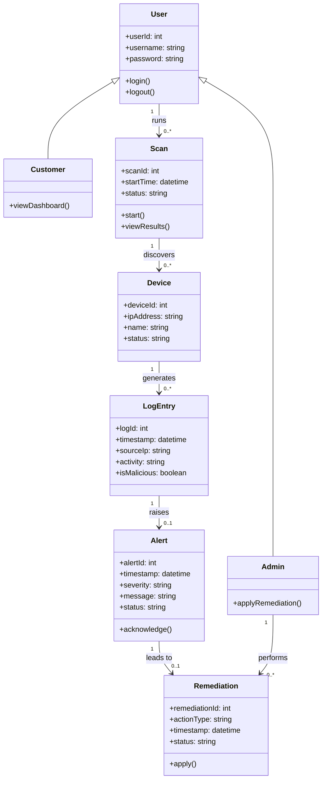

# LoNSeMonSy — Conceptual Class Diagram (Sprint 2)

A **conceptual** class diagram: it shows the **things our system needs to remember**, taken
straight from the SRS use cases (Login, Scan the Network, Log Activity, Alerts, Remediation).
It is *not* code — it's the plain-language picture of our data. Design-level detail comes later.

## How to read it (30 seconds)

Each **box** is a kind of thing we store. A box has three parts:

```
┌────────────────────┐
│  Alert             │  ← name: the thing
├────────────────────┤
│ + severity: string │  ← attributes: the details we remember about it
├────────────────────┤
│ + acknowledge()    │  ← methods: actions you can do to it
└────────────────────┘
```

The **lines** show how boxes connect. `1 --> 0..*` means "one of these connects to many of
those" (one Scan finds many Devices). A hollow **triangle** (`<|--`) means "is a kind of"
(a Customer *is a kind of* User).

## The diagram



## The story it tells (maps 1-to-1 to our SRS use cases)

1. **Login (3.1)** — A **User** logs in. A User is either a **Customer** or an **Admin**
   (that's the "is a kind of" triangle).
2. **Scan the Network (3.2)** — A User **runs** a **Scan**, which **discovers** the
   **Devices** on the network.
3. **Log Activity (3.3)** — Each **Device** **generates** **LogEntries** (what it's doing).
   A log entry is flagged `isMalicious` if it looks bad (e.g. an SSH brute-force).
4. **Alerts (3.4)** — A bad **LogEntry** **raises** an **Alert** (severity + message).
5. **Remediation (3.5)** — An **Alert** **leads to** a **Remediation** (block the IP, add a
   firewall rule, quarantine), which an **Admin** **performs**.

That's the whole product in one line: *scan → log → alert → fix*, and the diagram is just the
data behind each step.

## Notes for the team
- This is our draft — review it against the SRS and be ready to explain each box in the demo.
- Scope is still being settled; if a use case changes, add/rename a box here to match.
