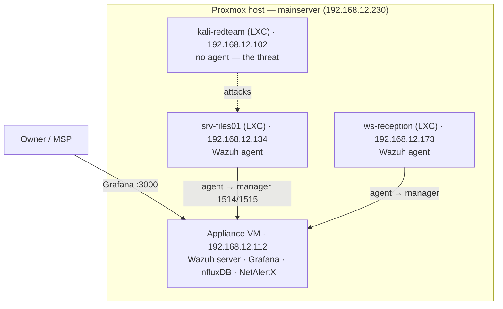

# Staging Environment

Staging is where a change gets tried **before** it reaches the live appliance. It has
two parts, and they are different things:

- **Staging appliance**: a separate copy of the appliance running the `staging`
  branch. Changes are installed here first.
- **Test lab**: a small fake company network (`srv-files01`, `ws-reception`,
  `kali-redteam`) that produces real attacks, so we can check that detection and
  auto-block still work after a change.

## How a change moves

1. **dev**: build and try it (`docker compose up` on any machine, see `DEV.md`).
2. **staging**: install it on the staging appliance, run the lab attacks, check Grafana.
3. **main**: if it passes, merge to `main` and apply it to the live appliance with
   `setup/update.sh`.

## Where the staging appliance runs

Today there is no hardware for a second full appliance: the Proxmox host has 16 GB
and the live appliance alone uses 8 GB. So for now:

- Before any change to the live appliance, take a PBS backup first. A full restore
  was measured at about 5 minutes (see `docs/RECOVERY.md` on the `recovery-docs` branch).
- The test lab below points at the live appliance.

**Next:** a dedicated mini PC running the `staging` branch, so staging is fully
isolated from the live appliance. It needs no Proxmox, only Ubuntu + Docker +
`setup/setup.sh`.

## Topology



All on `vmbr0` (the LAN), so the appliance sees the company's hosts and the agents reach the
manager. This mirrors how a customer's machines would report to a shipped appliance.

## Test lab inventory

| Machine | Role | Local IP |
|---|---|---|
| appliance (grafana-influxdb) | the SIEM | 192.168.12.112 |
| srv-files01 | monitored server (agent 001) | 192.168.12.134 |
| ws-reception | monitored workstation (agent 002) | 192.168.12.173 |
| kali-redteam | threat generator (no agent) | 192.168.12.102 |

## Building it

The lab is built by a script that runs **on the Proxmox host** (it needs `pct`):

```bash
scp ~/Main/testlab/build-company-lab.sh mainserver:/root/
ssh mainserver 'bash /root/build-company-lab.sh'
```

It creates the three LXCs, installs Wazuh agents on the two company machines pointed at the
appliance, and puts attack tools on the attacker. Footprint ≈ 1.3 GB RAM / ~12 GB disk.

## Validating detection (the demo)

1. Confirm the company machines registered, on the appliance:
   ```bash
   sudo /var/ossec/bin/agent_control -l      # expect srv-files01 + ws-reception
   ```
2. Run the SSH brute-force from the attacker (printed by the build script), then watch it
   land in Grafana (Wazuh datasource) or the Wazuh dashboard — rule 5710/5712 fires.

## Scope (be honest in the demo)

- **SSH brute-force: detected and auto-blocked.** Wazuh rule 5712 fires and the
  attacker's IP is dropped for 10 minutes (see `wazuh/TESTING.md`).
- **Port scan of other machines: not yet.** It needs a network traffic mirror the
  appliance doesn't have (see `docs/DECISIONS.md`). Present it as a known, scoped
  limitation, not a gap.

## Teardown

```bash
ssh mainserver 'for id in 8101 8102 8103; do pct stop $id; pct destroy $id; done'
```

## Branch

Work here is on the `staging` branch. Once a change passes, it merges to `main`,
which is what the live appliance (and a future customer appliance) runs.
