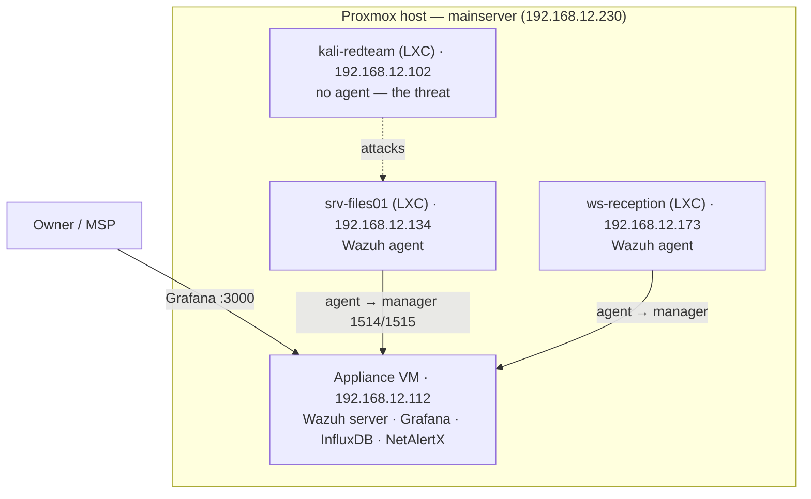

# Staging Environment

Staging is a **full deployment that mirrors a real customer site**, used to validate
detection end-to-end before release. It is the **appliance VM** (Wazuh server + the Docker
stack) plus a small **company test network** of monitored machines. Work here is on the
**`staging`** branch; a real customer appliance would be production.

## Topology



All on `vmbr0` (the LAN), so the appliance sees the company's hosts and the agents reach the
manager. This mirrors how a customer's machines would report to a shipped appliance.

## Staging inventory

| Machine | Role | Local IP |
|---|---|---|
| appliance (grafana-influxdb) | the SIEM | 192.168.12.112 |
| srv-files01 | monitored server (agent 001) | 192.168.12.134 |
| ws-reception | monitored workstation (agent 002) | 192.168.12.173 |
| kali-redteam | threat generator (no agent) | 192.168.12.102 |

## Building it

The lab is built by a script that runs **on the Proxmox host** (it needs `pct`):

```bash
scp ~/Main/testlab/build-company-lab.sh mainserver:/root/
ssh mainserver 'bash /root/build-company-lab.sh'
```

It creates the three LXCs, installs Wazuh agents on the two company machines pointed at the
appliance, and puts attack tools on the attacker. Footprint ≈ 1.3 GB RAM / ~12 GB disk.

## Validating detection (the demo)

1. Confirm the company machines registered, on the appliance:
   ```bash
   sudo /var/ossec/bin/agent_control -l      # expect srv-files01 + ws-reception
   ```
2. Run the SSH brute-force from the attacker (printed by the build script), then watch it
   land in Grafana (Wazuh datasource) or the Wazuh dashboard — rule 5710/5712 fires.

## Scope (be honest in the demo)

- **SSH brute-force: detected** — host-based, via the agent on `srv-files01`.
- **Port scan: not yet** — needs a network traffic mirror the appliance doesn't have (see
  `docs/DECISIONS.md`). The `nmap` step runs but isn't flagged. Present as a known, scoped
  limitation, not a gap.

## Teardown

```bash
ssh mainserver 'for id in 8101 8102 8103; do pct stop $id; pct destroy $id; done'
```

## Branch

Changes validated here are promoted from `dev`; once they pass, they merge to `main`
(release / a would-be production appliance).
